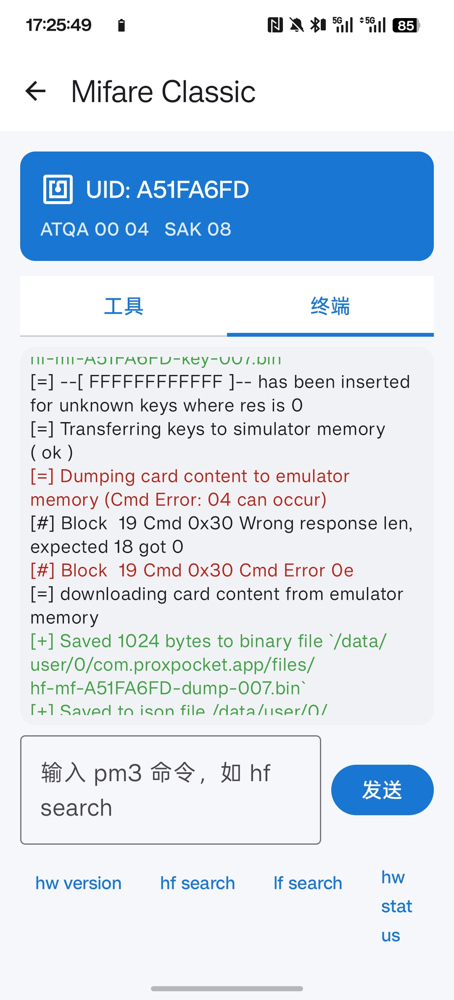

# ProxPocket

在 Android 手机上驱动 Proxmark3（PM3 Max / RDV4 / Easy 等）的 RFID 研究工具。
通过 USB OTG 直连设备，把完整的官方 pm3 客户端核心装进口袋：高频 IC 卡一键智能解析
（自动破解 Mifare Classic 密钥并读取数据）、三代无漏洞卡（FM11RF08S）静态随机数攻击、
低频 ID 卡读写、CPU 卡 / 公交卡信息、完整的终端命令交互。



**配套固件项目**：[PM3Max-OpenFW](https://github.com/zzqsld/PM3Max-OpenFW) —— 移植到
PM3 Max 硬件的 RRG v4.23346 固件（开源，含刷机脚本和 Windows 客户端）。

## 功能

- **高频 Mifare Classic**
  - 一键智能解析：自动识别卡型、跑 `hf mf autopwn`（默认密钥 / Nested / Hardnested /
    三代静态随机数 SEN 攻击），实时日志 + 完成后弹窗直达数据页
  - 密钥扫描、知一求全（Nested）、PRNG 解析、整卡读取
  - dump 按扇区浏览、块数据编辑、`.bin` / `.eml` 导入导出、文件名/UID 搜索
  - 写卡工具：写 UID/CUID/GDM/GTU、写空白卡、写有密卡、格式化、修改卡号、加密卡片、
    锁 UFUID（不可逆操作均有确认提示）
  - 卡片修复：修复 CUID/UID/UFUID/GDM 卡
- **低频**：lf search、读 ID、EM4100/HID/AWID 写 T5577、T55xx 检测与配置
- **CPU 卡 / 公交卡**：CPU 卡深度信息、DESFire（信息 / 密钥检测 / 整卡导出 / 应用列表）、
  深圳通 / 岭南通 / 一卡通等余额与交易记录读取
- **Ultralight / NTAG**：读取、密钥检测；**ISO15693**：读信息 / 整卡 / 读写块 / 写 UID
- **终端**：完整 pm3 命令行，快捷命令栏、日志复制/清空、运行计时、输出同步到 logcat
- **体验细节**：免连接可先浏览全部功能界面；操作完成/失败均有 Toast 提示；
  内置合并后的密钥字典（默认字典 + 常见系统密钥）

## 下载

[Releases](https://github.com/zzqsld/ProxPocket/releases) 页面提供编译好的 APK
（arm64-v8a，Android 8.0+）。手机需支持 USB OTG，配合 OTG 转接线连接 PM3 设备。

## 架构

```
┌─────────────── Kotlin / Jetpack Compose UI ───────────────┐
│  Connect / Home / Mifare / LowFreq / Terminal 等页面        │
├────────────────────────────────────────────────────────────┤
│  Pm3ViewModel：连接状态机 + 命令队列（串行执行）              │
├──────────────┬─────────────────────────────────────────────┤
│ UsbCdcDevice │  Pm3Core (JNI)                               │
│ (CDC-ACM 驱动)│  └─ libpm3bridge.so                          │
│     ↕ Bulk   │       ↕ pm3_open("tcp:127.0.0.1:port")       │
│  Pm3Bridge   │  libpm3rrg_rdv4.so（完整 pm3 客户端核心）     │
│  USB↔TCP 桥  │       （RRG/Iceman v4.23346 编译为库）        │
└──────────────┴─────────────────────────────────────────────┘
                          ↕ USB OTG
                    Proxmark3 设备
```

- 原生核心直接复用 RRG/Iceman 客户端（`third_party/rrg-tmp`，基于稳定版
  `v4.23346`），用其官方 `experimental_lib` 目标编译成共享库，因此
  `hf mf autopwn` 等全部客户端逻辑原样可用。
- 客户端 uart 层原生支持 `tcp:` 连接，App 侧 `Pm3Bridge` 在本机回环起 TCP 服务
  转发到 USB Bulk 端点，无需修改 uart 代码。
- pm3 运行资源（字典、hardnested 表、aidlist 等）打包在
  `app/src/main/assets/pm3/`，首次启动释放到 `filesDir/.proxmark3/`。

## 自行构建

需要：Android SDK（platform 36、build-tools、NDK 27.2、cmake 3.22.1）、JDK 17+。

```bash
# 1. 编译原生核心库（输出到 app/src/main/jniLibs/arm64-v8a/）
bash tools/build_pm3lib.sh

# 2. 编译 APK（首次会下载 Gradle）
./gradlew :app:assembleDebug
# 产物: app/build/outputs/apk/debug/app-debug.apk
```

`local.properties` 中需要 `sdk.dir=<Android SDK 路径>`。

## 目录

- `app/` — Android 应用（Kotlin + Compose）
- `third_party/rrg-tmp` — RRG/Iceman 客户端源码（v4.23346 + Android 适配改动：
  `client/src/pm3.c` 避免错误路径直接退出 App、`experimental_lib/CMakeLists.txt`
  构建参数、版本信息），是 `libpm3rrg_rdv4.so` 的全部对应源码
- `tools/` — 原生库构建脚本、字典合并脚本、调试小工具
- `docs/` — 截图

## 致谢

- [RRG/Iceman proxmark3](https://github.com/RfidResearchGroup/proxmark3) — 本 App 的
  全部读卡能力来自该项目（GPLv3）
- PM3 Max 硬件厂商及其上位机软件（兼容性参考）

## 免责声明

本工具仅用于安全研究、学习和自己持有的卡片/设备的测试。请勿用于未经授权读取、
复制或篡改他人卡片与门禁/支付系统，使用者需自行遵守当地法律法规。

## 许可证

[GPLv3](LICENSE.txt)。本 App 链接了 RRG/Iceman proxmark3（GPLv3）编译的核心库，
整体按 GPLv3 发布；`third_party/rrg-tmp` 即核心库的完整对应源码。
